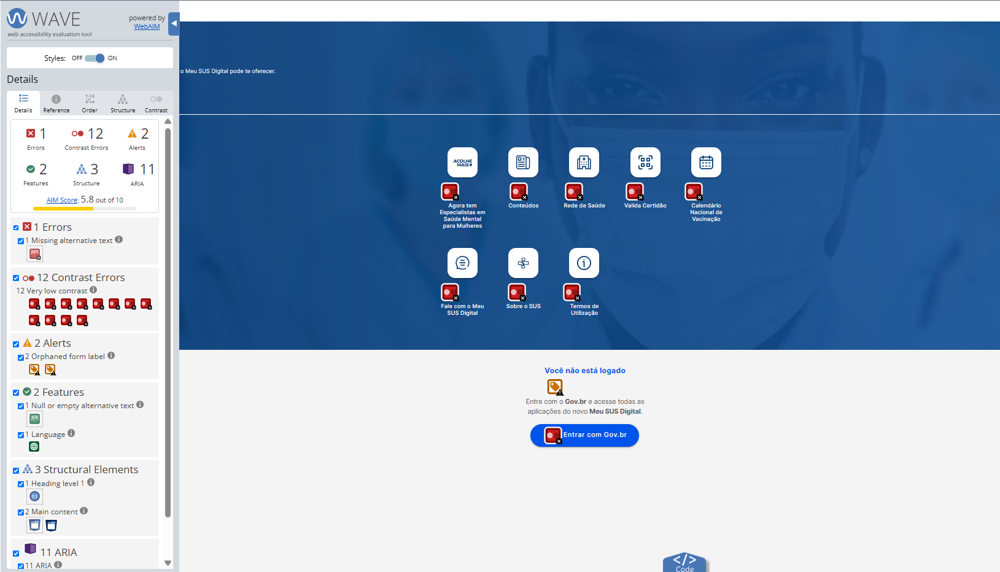
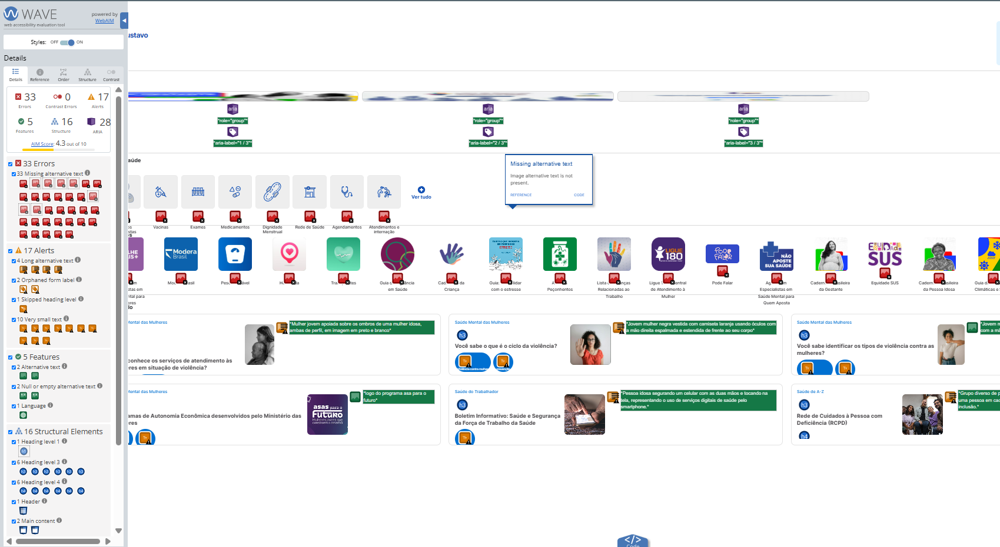
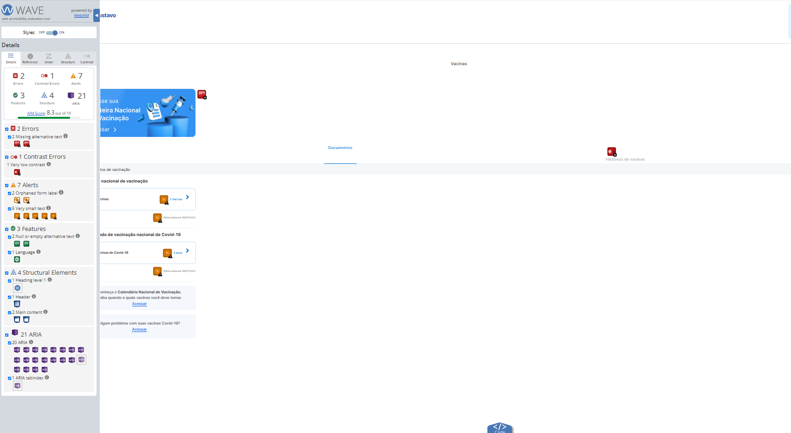
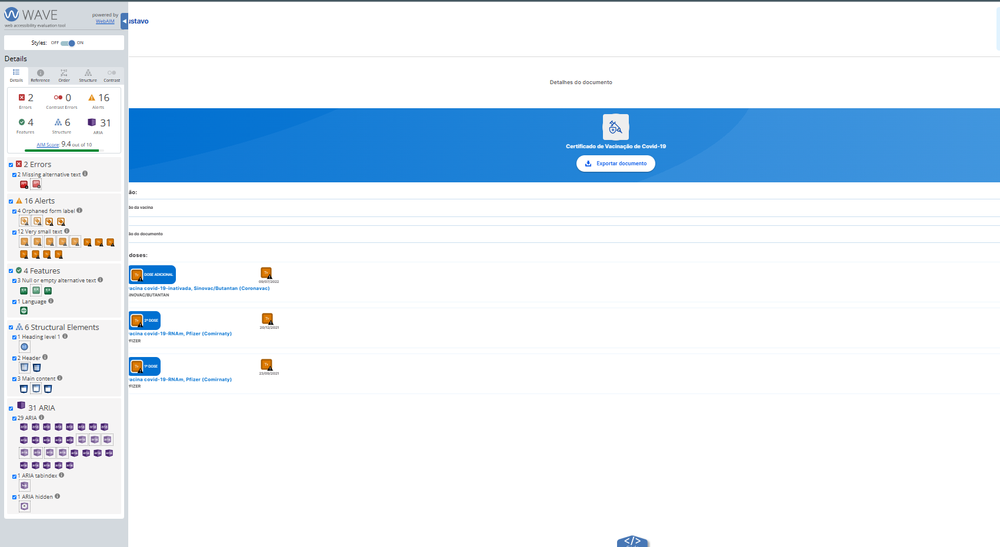

# Aplicação do Checklist no Meu SUS Digital

Esta página demonstra a aplicação prática do checklist de acessibilidade do
Grupo 05 no **Meu SUS Digital**. Os resultados foram consolidados a partir da
inspeção descrita no [Relatório de Inspeção](./introducao.md), das evidências
produzidas com o WAVE e da validação qualitativa dos elementos apontados pela
ferramenta.

> **Importante:** o WAVE é uma ferramenta de apoio. Um erro automático é
> registrado como evidência técnica, mas alertas precisam de validação humana.
> A ausência de um alerta também não comprova, sozinha, conformidade total.

## 1. Escopo e método

| Informação | Registro |
| --- | --- |
| Sistema avaliado | Meu SUS Digital |
| URL pública | [meususdigital.saude.gov.br](https://meususdigital.saude.gov.br/) |
| Fluxos e telas | Página pública/deslogada, página inicial autenticada, Minha Saúde/Vacinas e Detalhes do Documento |
| Ferramenta de apoio | WAVE (Web Accessibility Evaluation Tool) |
| Verificações complementares | Inspeção visual da interface, leitura da estrutura indicada pelo WAVE e relação com as heurísticas de Nielsen |
| Referenciais | WCAG 2.2, nível AA; ABNT NBR 17225:2025; Guia de Boas Práticas para Acessibilidade Digital do Gov.br |
| Legenda | ✅ Conforme · ⚠️ Parcialmente conforme/necessita validação · ❌ Não conforme · ➖ Não aplicável |

O objetivo desta etapa não é atribuir uma certificação ao serviço, mas
documentar barreiras observáveis e indicar como elas podem ser corrigidas.

## 2. Resultado consolidado

| ID | Item do checklist aplicado | Página pública | Página inicial autenticada | Vacinas | Detalhes do documento |
| --- | --- | :---: | :---: | :---: | :---: |
| C01 | Texto e controles possuem contraste suficiente | ❌ | ✅ | ❌ | ✅ |
| C02 | Imagens informativas possuem texto alternativo adequado | ❌ | ❌ | ❌ | ❌ |
| C03 | Textos alternativos são objetivos e não excessivos | ✅ | ⚠️ | ✅ | ✅ |
| C04 | Campos e controles possuem rótulos programáticos | ⚠️ | ⚠️ | ⚠️ | ❌ |
| C05 | A hierarquia de cabeçalhos e a estrutura são lógicas | ⚠️ | ❌ | ⚠️ | ⚠️ |
| C06 | Textos permanecem legíveis em tamanho e ampliação | ⚠️ | ❌ | ❌ | ❌ |
| C07 | Navegação por teclado, foco e componentes interativos | ⚠️ | ⚠️ | ⚠️ | ⚠️ |

Os itens C03 e C07 foram classificados como **necessitando validação** porque
os dados disponíveis no relatório e no WAVE não são suficientes para concluir
uma aprovação ou reprovação completa. Eles exigem teste manual com leitor de
tela, teclado e zoom.

## 3. Evidências quantitativas do WAVE

| Tela | AIM Score | Erros | Erros de contraste | Alertas | Recursos | Estrutura | ARIA |
| --- | :---: | ---: | ---: | ---: | ---: | ---: | ---: |
| Página pública/deslogada | 5,8/10 | 1 | 12 | 2 | 2 | 3 | 11 |
| Página inicial autenticada | 4,3/10 | 33 | 0 | 17 | 5 | 16 | 28 |
| Minha Saúde/Vacinas | 8,2–8,3/10 | 2 | 1 | 7–14 | 3 | 4 | 21–22 |
| Detalhes do Documento | 9,4/10 | 2 | 0 | 16 | 4 | 6 | 31 |

O AIM Score não substitui a análise dos critérios do checklist. Uma pontuação
mais alta pode coexistir com barreiras importantes, especialmente quando o
problema exige avaliação manual.

## 4. Problemas documentados

### C01 — Baixo contraste nos rótulos de serviços

**Resultado:** ❌ Não conforme

**Evidência:** o WAVE identificou **12 erros de contraste** na página
pública/deslogada. Os rótulos dos serviços aparecem sobre uma imagem de fundo
azulada, dificultando a leitura.

**Referências relacionadas:**

- WCAG 2.2 — 1.4.3, Contraste mínimo (nível AA);
- ABNT NBR 17225:2025 — requisitos de legibilidade e contraste em conteúdo
  web;
- Guia Gov.br — uso de contraste suficiente para texto e componentes.

**Impacto:** pessoas com baixa visão, daltonismo, pessoas idosas e usuários em
ambientes com muita luminosidade podem não identificar os serviços disponíveis.

**Recomendação:** aplicar uma superfície sólida ou uma sobreposição de cor
mais escura atrás dos rótulos e confirmar a razão de contraste com uma
ferramenta específica. A correção deve preservar o conteúdo em diferentes
tamanhos de tela.

*Evidência C01 — página pública/deslogada com erros de contraste apontados pelo
WAVE.*

---

### C02 — Imagens sem texto alternativo

**Resultado:** ❌ Não conforme

**Evidência:** foram registrados **1 erro** na página pública, **33 erros** na
página inicial autenticada e **2 erros** nas telas internas, relacionados à
ausência de texto alternativo em imagens e ícones.

**Referências relacionadas:**

- WCAG 2.2 — 1.1.1, Conteúdo não textual (nível A);
- ABNT NBR 17225:2025 — descrição textual de conteúdo não textual;
- Guia Gov.br — textos alternativos para imagens informativas.

**Impacto:** pessoas que utilizam leitores de tela não recebem a informação de
campanhas, imagens ou controles representados visualmente.

**Recomendação:** adicionar texto alternativo curto e equivalente em imagens
informativas. Para imagens puramente decorativas, utilizar `alt=""` ou
ocultá-las da tecnologia assistiva sem retirar informação necessária.

*Evidência C02 — página inicial autenticada com ocorrências de ausência de
texto alternativo.*

---

### C03 — Textos alternativos excessivamente longos

**Resultado:** ⚠️ Parcialmente conforme / necessita validação manual

**Evidência:** foram registrados **4 alertas** na página inicial autenticada
para textos alternativos longos. O alerta do WAVE precisa ser conferido
manualmente: uma descrição pode ser extensa e ainda ser necessária quando a
imagem transmite informação essencial.

**Referências relacionadas:**

- WCAG 2.2 — 1.1.1, Conteúdo não textual (nível A);
- ABNT NBR 17225:2025 e Guia Gov.br — descrição adequada ao propósito do
  conteúdo.

**Impacto:** descrições prolixas podem tornar a navegação linear cansativa e
atrasar o acesso às informações de saúde.

**Recomendação:** manter no `alt` apenas o significado necessário para a ação
ou compreensão da página. Quando uma descrição detalhada for indispensável,
disponibilizá-la no conteúdo da página ou por uma relação acessível, em vez de
concentrar toda a informação no texto alternativo.

---

### C04 — Rótulos de formulário não associados aos campos

**Resultado:** ⚠️ Parcialmente conforme na página pública, na página inicial e
em Vacinas; ❌ Não conforme em Detalhes do Documento

**Evidência:** o relatório registrou rótulos órfãos em todas as telas: **2
alertas** na página pública, **2** na página inicial, **2** em Vacinas e **4**
em Detalhes do Documento.

**Referências relacionadas:**

- WCAG 2.2 — 1.3.1, Informações e relações (nível A);
- WCAG 2.2 — 3.3.2, Rótulos ou instruções (nível A);
- ABNT NBR 17225:2025 e Guia Gov.br — identificação clara de campos e
  controles.

**Impacto:** leitores de tela podem anunciar apenas “campo de texto”, sem
informar qual dado deve ser digitado. Isso aumenta a chance de erro,
especialmente no acesso e na consulta de informações de saúde.

**Recomendação:** associar cada campo a um `label` visível por meio de `for` e
`id` correspondentes. Instruções, obrigatoriedade e mensagens de erro também
devem ser relacionadas programaticamente ao campo.

---

### C05 — Quebra na hierarquia de cabeçalhos

**Resultado:** ⚠️ Parcialmente conforme nas demais telas; ❌ Não conforme na
página inicial autenticada

**Evidência:** na página inicial autenticada foi observado salto de `h1` para
`h3` e `h4`, sem o nível intermediário `h2`. A página pública apresenta
estrutura semântica limitada.

**Referências relacionadas:**

- WCAG 2.2 — 1.3.1, Informações e relações (nível A);
- WCAG 2.2 — 2.4.6, Títulos e rótulos (nível AA);
- ABNT NBR 17225:2025 e Guia Gov.br — organização semântica e navegação por
  títulos.

**Impacto:** pessoas que navegam por títulos usando leitor de tela têm
dificuldade para compreender a organização e localizar uma seção específica.

**Recomendação:** utilizar um único `h1` para o título principal da tela,
`h2` para as seções funcionais e níveis seguintes apenas para subseções
hierarquicamente relacionadas. A aparência visual deve ser ajustada por CSS,
não por saltos de nível.

---

### C06 — Textos e dados de saúde muito pequenos

**Resultado:** ⚠️ Parcialmente conforme na página pública; ❌ Não conforme na
página inicial, em Vacinas e em Detalhes do Documento

**Evidência:** o relatório registra alertas de texto muito pequeno,
especialmente em datas de vacinação, nomes de vacinas e dados de lote. Foram
registrados **10 alertas** na página inicial, até **9** em Vacinas e **12** em
Detalhes do Documento.

**Referências relacionadas:**

- WCAG 2.2 — 1.4.4, Redimensionamento de texto (nível AA);
- ABNT NBR 17225:2025 — legibilidade e adaptação do conteúdo;
- Guia Gov.br — conteúdo legível e utilizável por pessoas com baixa visão.

**Impacto:** usuários idosos ou com baixa visão podem não conseguir consultar
datas, lotes e nomes de vacinas, que são informações essenciais.

**Recomendação:** utilizar unidades relativas, evitar texto inferior ao
necessário para a leitura e testar a página com ampliação de até 200%, sem
perda de conteúdo ou funcionalidade.

*Evidência C06 — tela de Vacinas analisada com o WAVE.*

---

### C07 — Navegação por teclado, foco e componentes interativos

**Resultado:** ⚠️ Necessita validação manual

**Evidência:** os dados disponíveis nesta etapa apresentam a estrutura ARIA e
alertas do WAVE, mas não registram uma sessão completa utilizando somente
teclado ou leitor de tela. Por isso, não é correto declarar conformidade
apenas com base no resultado automático.

**Referências relacionadas:**

- WCAG 2.2 — 2.1.1, Teclado (nível A);
- WCAG 2.2 — 2.4.7, Foco visível (nível AA);
- WCAG 2.2 — 4.1.2, Nome, função e valor (nível A);
- ABNT NBR 17225:2025 e Guia Gov.br — operabilidade e compatibilidade com
  tecnologias assistivas.

**Impacto:** pessoas com deficiência motora ou visual podem não conseguir
abrir menus, acionar botões, preencher campos ou compreender o estado de um
componente.

**Próximo teste:** percorrer cada fluxo somente com `Tab`, `Shift+Tab`,
`Enter`, `Espaço` e `Esc`; registrar a ordem do foco, a visibilidade do foco,
o comportamento de menus e o retorno do foco após fechar diálogos. Repetir
com um leitor de tela.

*Evidência C07 — tela de Detalhes do Documento utilizada no escopo da inspeção.*

## 5. Síntese dos achados

Os problemas mais relevantes encontrados foram:

1. baixo contraste na página pública;
2. ausência de texto alternativo em imagens;
3. rótulos de formulário sem associação programática;
4. quebra da hierarquia de cabeçalhos;
5. textos muito pequenos em informações de vacinação;
6. necessidade de testes manuais de teclado e leitor de tela.

Esses achados mostram como o checklist transforma uma diretriz abstrata em
uma verificação concreta: cada item é associado a uma tela, a uma evidência,
ao impacto para uma pessoa usuária e a uma recomendação de correção. A
avaliação não representa uma certificação de conformidade do Meu SUS Digital;
é um registro acadêmico do escopo observado pelo grupo.
